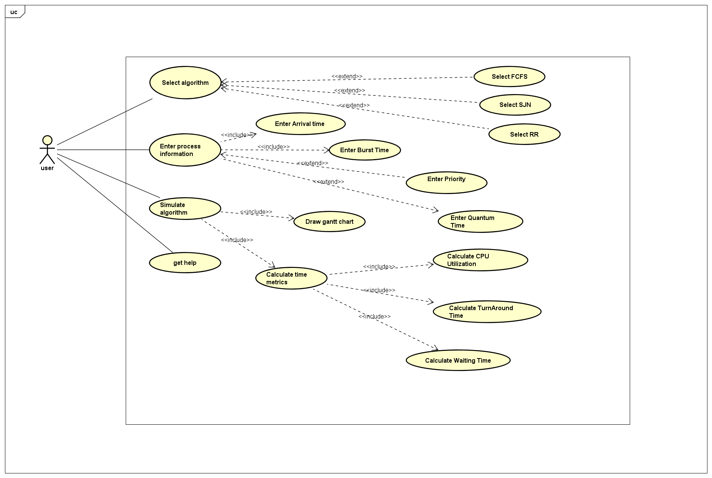
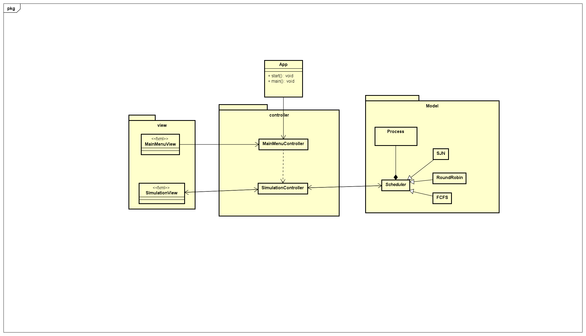
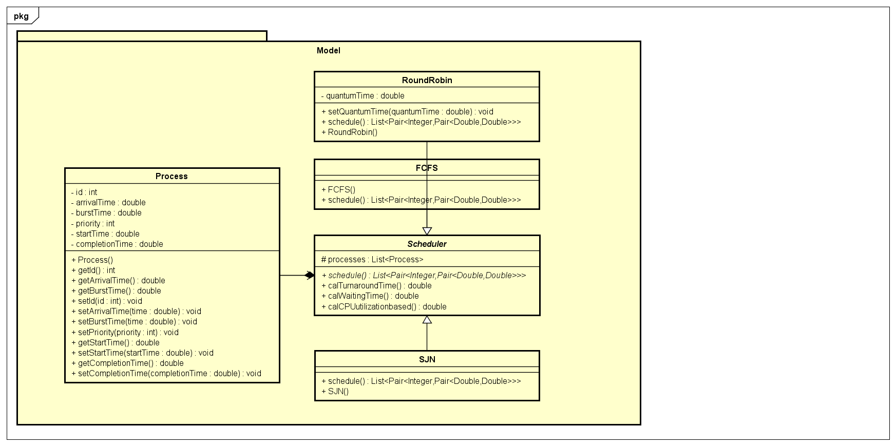
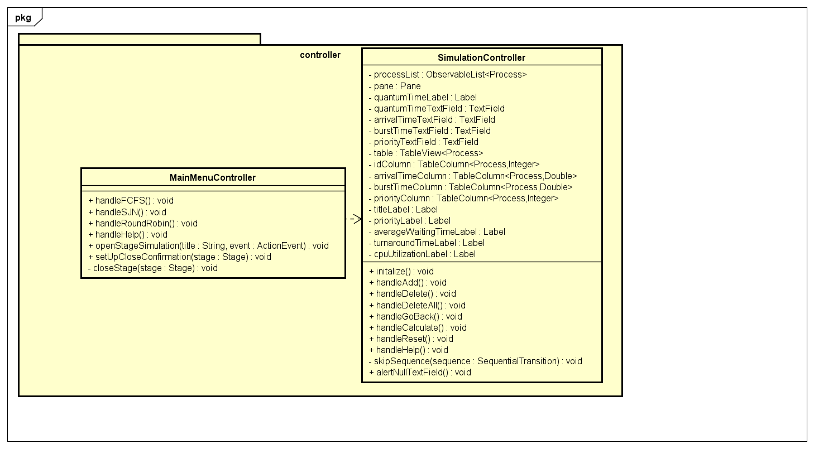
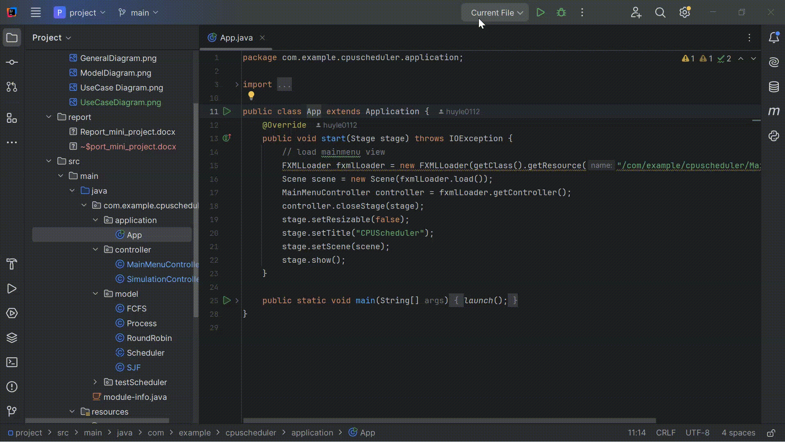

# CPU Scheduler

I. Design

1, Use case Diagram

2, General Diagram

- The Controller package controls the program flow, receives user requests through the program interface, processes the requests, and provides the corresponding output.
- The View package contains classes that create the program interface, including the Main Menu and Simulation View.
- The App class serves as the access point of the program.
- The Model package contains classes that handle data processing for the program. The Process class represents a process, while the abstract parent class Scheduler represents scheduling

3, Model Diagram

- Process Class: Includes process parameters and setter/getter methods.
- Scheduler Class: Has a single attribute, which is a list of processes. The schedule() method returns data as input for the Gantt chart and is an abstract class. Other methods calculate scheduling performance.
- FCFS, SJF, RoundRobin Classes: Implement the schedule() method and perform scheduling for the sequence of processes.

4, Controller Diagram

- MainMenuController class: Controls the MainMenuView class. The handle() methods are responsible for opening the simulation stage corresponding to the selected algorithm stored in the stageCurrent variable. Lastly, it includes methods for creating a confirmation dialog when the user wants to close the application.
- SimulationController class: Contains the input process table along with process attributes and text fields for receiving user input. The output includes a scheduled process table handled by the CPU, along with calculated parameters and a Gantt chart.

II. Demo

III. Evaluation

- Project:

  Advantages: Met the requirements of the assignment, fully applied object-oriented programming principles, and followed the MVC model despite having a basic design.

  Disadvantages: The interface is still rudimentary, and the functionalities are not clearly presented to users.

- Personal Performance:

  Advantages: In this major assignment, I took on the role of leader. My team members had weak knowledge and initially struggled with slow progress. Upon realizing this, I adjusted the workflow accordingly, proactively completing the critical parts of the project first so that my teammates could more easily complete their tasks. As a result, our team achieved a high score.

  Disadvantages: At first, I designed the structure incorrectly and wrote unoptimized code, which affected my teammates and forced them to restart their work. In the final version, my design contained an error in the output of the schedule() method—the data type used was not well-suited for object-oriented programming. Replacing it with a class would have made the result more complete.

